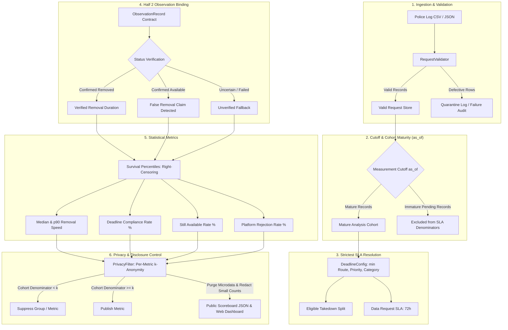

# Methodology & Metric Specifications

This document outlines the scientific definitions, mathematical formulas, data filtering logic, privacy controls, and audit limitations governing **Half 1: Requests and Speed** and the shared observation integration with **Half 2: Verification and Integrity** within the Social Media Takedown Accountability Platform.

> **Demonstration Notice**:
> In demonstration mode, this platform uses 100% synthetic records with **fictional platform identities** (`Platform A` through `Platform J`) and simulated profiles. Figures generated from synthetic data do not represent genuine intermediary compliance, actual platform responsiveness, or real police investigations. Real platform names (`Meta`, `YouTube`, etc.) are reserved strictly for authorized, isolated law enforcement deployment.

---

## 1. System Dataflow & Processing Architecture

---

## 2. Statutory Deadlines & Strictest Resolution (2026 IT Rules)

### 2.1. Statutory Timelines
Amended timelines under the Information Technology (Intermediary Guidelines and Digital Media Ethics Code) Rules, 2021 (amended effective 20 February 2026; Gazette notification 269993):

1. **Rule 3(1)(d) (Specified Court Orders or Authorized Government Intimations)**:
   - **Deadline**: **3.0 hours** from formal communication.
   - **Applicable Route**: `court_order_or_govt_intimation`.
2. **Rule 3(2)(b) (Grievance Complaints on Specified Harm Categories)**:
   - **Deadline**: **2.0 hours** from receipt of complaint.
   - **Qualifying Categories**: Child Sexual Abuse Material (`CSAM`), Non-Consensual Intimate Imagery and morphed content (`NonConsensualImagery`), and `Impersonation`.
   - **Critical Rule**: The 2-hour deadline does **not** automatically apply to every request labeled NCII; the legal route must be `grievance_complaint_3_2_b`.
3. **Operational Priorities**:
   - `emergency_life_threat`: **2.0 hours** (imminent danger to human life).
   - `urgent`: **3.0 hours** (priority operational escalation).
   - `routine`: **36.0 hours** (standard operational default).
4. **Data Assistance Requests**:
   - **Deadline**: **72.0 hours** under statutory data-assistance provisions. Content-removal SLAs are **never** applied to data requests.

### 2.2. Conflict Resolution Order
When multiple deadlines are applicable (e.g., category default, legal route, and operational priority), the engine selects the **strictest applicable deadline**:

$$\text{Effective Deadline} = \min(\text{Applicable Candidates})$$

*Example*: If Harm Category = `FinancialFraud` (36h default), Operational Priority = `urgent` (3h), and Legal Route = `court_order_or_govt_intimation` (3h):
$$\text{Selected Deadline} = \min(36.0, 3.0, 3.0) = 3.0\text{ hours}$$

An urgent priority is never silently ignored or relaxed by a category default.

### 2.3. Statutory Police Intimations vs. Operational Assumptions
1. **Rule 3(1)(d) Police Intimations (3.0 Hours)**:
   Formal police takedown notices issued under Section 79(3)(b) by an authorized law enforcement officer or agency constitute authorized government intimations under Rule 3(1)(d). Under the 2026 amendments (Gazette No. 269993), these carry a mandatory **3.0-hour** compliance deadline.
2. **Operational Fallback Assumptions**:
   Non-statutory communications or informal inquiries (`routine_police_inquiry`) fall back to operational defaults (36.0 hours).
3. **Ambiguous or Missing Route Information**:
   If `legal_route` is absent or `other`, the engine relies strictly on applicable category and priority rules. It does not fabricate a statutory 2h or 3h compliance route without supporting evidence. Law enforcement logs must record `court_order_or_govt_intimation` or `grievance_complaint_3_2_b` to trigger statutory SLA tracking.

---

## 3. Measurement Cutoff (`as_of`) and Cohort Maturity

To prevent temporal bias where pending requests submitted shortly before report generation are unfairly penalized:

1. **Explicit Reporting Cutoff (`as_of`)**:
   Every calculation accepts an ISO 8601 UTC timestamp `as_of`. If not provided, it defaults to a single UTC timestamp captured at report generation start.
2. **Takedown Cohort Maturity Rule**:
   A takedown enters the mature analysis cohort if and only if:
   - It was verified removed before `as_of` ($\text{verified\_removed\_at} \le \text{as\_of}$); OR
   - It was claimed removed before `as_of` ($\text{claimed\_removal\_at} \le \text{as\_of}$) and the verifier has not contradicted the claim (section 6.3); OR
   - It was rejected before `as_of` ($\text{sent\_at} \le \text{as\_of}$); OR
   - Its applicable deadline has elapsed by `as_of` ($\text{sent\_at} + \text{deadline\_hours} \le \text{as\_of}$).
3. **Data Request Cohort Maturity Rule**:
   A data assistance request enters the mature data cohort if and only if:
   - Data was provided before `as_of` ($\text{data\_provided\_at} \le \text{as\_of}$); OR
   - It was rejected before `as_of` ($\text{sent\_at} \le \text{as\_of}$); OR
   - Its statutory 72-hour deadline has elapsed by `as_of` ($\text{sent\_at} + 72.0\text{h} \le \text{as\_of}$).
4. **Immature Pending Exclusions**:
   Requests whose deadlines have not yet elapsed by `as_of` are **immature**. They are strictly excluded from compliance denominators and speed percentiles. A data request sent 30 minutes before export cannot drop compliance from 100% to 95%.

---

## 4. Removal-Time Percentiles & Right-Censoring

### 4.1. The Survivorship Bias Problem
Calculating median and p90 removal times using only requests marked `claimed_removed` creates severe survivorship bias. For example, if Platform A removes 20 requests in 10 hours, while Platform B removes 10 in 1 hour and leaves 10 unresolved indefinitely, an un-censored calculation would report Platform B as 10x faster (1.0h vs 10.0h).

### 4.2. Survival Analysis Formulation
We calculate removal-time percentiles over the entire eligible, mature takedown cohort of size $N$:

$$N = k + U$$
where:
- $k$: count of confirmed removals with finite observed durations $t_0 \le t_1 \le \dots \le t_{k-1}$.
- $U$: count of mature unresolved requests (content still available past deadline), treated as right-censored outcomes with duration $> \text{deadline}$ (conceptually $+\infty$).

For any target percentile $p \in [0, 100]$:
$$\text{Rank} = \frac{p}{100} \times (N - 1)$$
$$i_{\text{low}} = \lfloor \text{Rank} \rfloor, \quad i_{\text{high}} = \lceil \text{Rank} \rceil$$

1. **Finite Rank ($i_{\text{high}} < k$)**:
   Both bounds fall within the finite durations:
   $$\text{Percentile} = t_{i_{\text{low}}} + (\text{Rank} - i_{\text{low}}) \times (t_{i_{\text{high}}} - t_{i_{\text{low}}})$$
   Serialized as finite number `numeric_hours`, `is_censored = false`.
2. **Right-Censored Rank ($i_{\text{high}} \ge k$)**:
   The percentile rank touches or falls into the unremoved, censored outcomes.
   Serialized safely as:
   - `numeric_hours: null` (never `Infinity` or `NaN`)
   - `is_censored: true`
   - `display: "> measurement window"`

In the Platform A vs Platform B example:
- **Platform A**: $N=20, k=20$. Rank for median = 9.5 ($< 20$). Median = **10.0 hours**.
- **Platform B**: $N=20, k=10$. Rank for median = 9.5. Upper index $10 \ge k (10)$. Median is **right-censored** (`> measurement window`), not 1.0 hour.

---

## 5. Separate Platform Rejection Reporting

1. **Rejection Outcome Isolation**:
   Platform refusals (`status == 'rejected'`) are audited in separate metrics (`rejections_count` and `rejection_rate_pct`).
2. **Non-Equivalence Rules**:
   - A rejection is **not** counted as content removal.
   - A rejection is **not** automatically counted as confirmed content availability (unless verified by an independent observation).
   - Rejections do not distort the removal-time speed distribution.
3. **Privacy Protection**:
   Small rejection counts ($< k$) are redacted from public output to prevent disclosure.

---

## 6. Verification and Accountability (Half 2): Use Cases

Platforms report their own removal times. This part of the system checks independently whether reported content is really gone, so the scoreboard does not rely on the platform's word. Each use case below describes a real situation, what the system does, and what the public ends up seeing.

The people involved:
* **Victim**: the person the content harms.
* **Police cyber cell**: sends takedown requests and runs this system on its own computers.
* **Platform**: the social media company that receives the request.
* **Public**: sees only the published scoreboard.

---

### Use case 1: Checking that reported content is really gone

**Example.** Police ask a platform to remove a morphed image at 10:00. The platform replies "removed at 11:05".

**What happens.**
1. From the moment the request is sent, the system checks the post every 15 minutes.
2. A removal counts only when two checks in a row find the post gone, so one glitch doesn't count as removal.
3. The checker only looks at whether the post is reachable. It never downloads or stores the image.
4. For each request it records four times: first check, last time the post was seen online, time it was confirmed gone, and last check. No links, images or notes are recorded.

**Result.** The scoreboard uses the time the checks confirmed (within 15 minutes of the real removal), not the platform's claim.

---

### Use case 2: The platform says "removed" but the content is still online

**Example.** The platform reports removal at 11:00, but the checks keep finding the post online until 6:00 the next morning. It finally disappears at 6:15.

**What happens.**
1. Because the post was seen online after the platform said it was removed, the claim is counted as a **false removal claim**.
2. The removal time used is 6:15 the next morning, so the platform is measured on what actually happened.
3. A 15-minute allowance covers cached copies, so a post briefly visible right after a genuine removal is not counted against the platform.

**What the public sees.** Each platform's false removal claim rate: the share of its removal claims that the checks contradicted.

---

### Use case 3: The platform removes content without telling the police

**Example.** The platform never replies, but the checks find the post gone at 15:00.

**What happens.** The post counts as removed at 15:00, even though the platform's status still says "pending". The platform is not penalised for content it actually removed.

**What the public sees.** The number of silent removals per platform: content taken down without a report back.

---

### Use case 4: The content can't be checked

**Example.** The post sits behind a login wall, or on a private account, or is blocked in the region where the checks run.

**What happens.**
1. The request is recorded as **could not check**, with a fixed reason code (for example "login wall").
2. The system never assumes removal on its own. If the platform claims removal, that claim is used, but it is not marked as confirmed.

**What the public sees.** The share of requests that could not be checked, so readers know how much of a platform's figures rest on its own word.

---

### Use case 5: The removed content comes back

**Example.** A week after removal, a copy of the same image is posted again.

**What happens.**
1. When police send the takedown, they register a **fingerprint** of the image inside police systems. The fingerprint is PDQ, the open image-matching method Meta publishes for exactly this purpose.
2. After a confirmed removal, posts that turn up on the platform over the next 7 days are fingerprinted the same way and compared.
3. A copy still matches if it was resized, recompressed, recoloured or mirrored. Heavily cropped or edited copies can be missed.
4. Fingerprints never leave the system. The report only records when a copy was found.

Our PDQ code gives exactly the same fingerprints as Meta's official version, which the tests check. The demo uses abstract generated pictures, never real images.

**What the public sees.** Each platform's re-upload rate. It only includes removals whose 7-day watch has finished, so recent removals don't make the rate look better than it is.

---

### Use case 6: A platform disagrees with the monthly report

**Example.** Platform E says two requests counted against it were the same image reported twice.

**What happens.**
1. After the month closes, police share a draft report. Each platform also gets the list of its own requests as the report counted them, to compare with its records. The list has no links or images.
2. The platform has 7 days to raise a dispute. It picks a reason from a fixed list and adds a short explanation. Explanations containing links are refused.
3. Police accept or reject each dispute with a note. Accepting has a fixed effect:

| Reason | What happens if accepted |
| :--- | :--- |
| Wrong platform, duplicate, or wrong month | The request is left out of the report |
| The police request was incomplete | The request is not counted against the platform |
| Wrong removal time | The platform's time is corrected (a confirmed check still takes priority) |
| Our check was wrong | That check is set aside and the platform's claim is used |
| Other | Recorded, no automatic change |

4. The report can't be published while the 7 days are running or while any dispute is unanswered.

**What the public sees.** For each platform: how many disputes it raised, how many were accepted or rejected, and which numbers were disputed. Explanations, police notes and request numbers are never published.

---

### Use case 7: A victim wants to know what is happening

**Example.** Someone whose morphed photo was posted online wants to know whether it has been taken down, without calling the police station every day.

**What happens.**
1. When the complaint is registered, police give the victim the reference number and a private 12-character access code.
2. On the status page they enter both and see: when the request was sent, the legal deadline and whether it was met, how long it has taken so far, what the platform says, what the independent check found, and whether a copy turned up later.
3. They never see the content category, the platform, links or police details, so even a leaked code reveals very little.
4. A wrong code and an unknown reference get exactly the same message. After 5 wrong tries the page makes them wait 15 minutes, which stops anyone guessing codes.
5. Codes are stored only in scrambled (hashed) form, and the page loads nothing from other websites.

---

### What the public numbers mean

| Number | In plain words |
| :--- | :--- |
| Verification coverage | Out of all requests, how many the system was able to watch |
| Could not check | Out of watched requests, how many could not be seen (login walls, private accounts) |
| False removal claim rate | Out of removal claims the system could test, how many were contradicted by the checks |
| Silent removals | Removals the checks confirmed that the platform never reported |
| Re-upload rate | Out of confirmed removals with a finished 7-day watch, how many came back |

**Privacy rule.** A number is published only if at least 10 requests are behind it. A count and its percentage are always shown or hidden together, so a hidden number can't be worked out from the others.

---

### Limits to keep in mind

* Removal times are accurate to about 15 minutes, because that is how often the checks run.
* The demo runs entirely on made-up data for fictional platforms (Platform A to J). Its numbers say nothing about real companies.
* Content removed and later restored at the same address is not tracked after the confirmed removal.
* A re-upload is only counted if the system can see it, and heavily cropped or edited copies can be missed, so the re-upload rate is a minimum, not an exact figure.

Technical reference: the record the checker hands over

One record per watched request (`schemas/observation.schema.json`):

| Field | Meaning |
| :--- | :--- |
| `observation_status` | `confirmed_removed`, `confirmed_available` (online at last check), `uncertain` (could not see the content) or `failed_check` (checks errored) |
| `first_checked_at` / `last_checked_at` | First and most recent check |
| `last_seen_up_at` | Last check that found the post online |
| `verified_removed_at` | First of two checks in a row that found it gone |
| `reupload_detected_at` | First copy found after removal |
| `check_error` | Reason code when checks were inconclusive (no free text) |

Rules, in `src/takedown_tracking/integrity/rules.py`: a confirmed removal time replaces the platform's claim; a claim is false if the post was seen online more than 15 minutes after it; with no usable check, the platform's claim is used. Checks go through the `AvailabilityChecker` and `ReuploadDetector` interfaces, so a real deployment can plug in its own checker inside the police network.

Re-upload matching (`src/takedown_tracking/hashing/pdq.py`, `verifier/pdq_detector.py`): a copy matches when its PDQ fingerprint differs from the registered one in at most 31 of 256 bits, in any of the 8 rotations or mirror images, and both fingerprints have a quality score of at least 50.

Disputes (`src/takedown_tracking/disputes/`): each reporting month is a report cycle file held by the police (`schemas/report_cycle.schema.json`) with every dispute, its reason, request numbers, explanation and decision. Only counts reach the public scoreboard.

Victim status (`src/takedown_tracking/victim_status/`, page at `/status`): codes are 60-bit random values stored as salted PBKDF2-SHA256 hashes; lookups go through `POST /api/status`, which is never cached and limited to 5 failures per visitor and 10 per reference every 15 minutes.

---

## 7. URL Cryptographic Pseudonymization (HMAC-SHA-256)

1. **Vulnerability of Plain SHA-256**:
   Plain SHA-256 hashes of known candidate URLs are vulnerable to dictionary pre-computation and re-identification attacks.
2. **HMAC-SHA-256 Standard**:
   All URL identifiers use HMAC-SHA-256 keyed with a deployment secret (`TAKEDOWN_HMAC_SECRET`):
   $$\text{content\_url\_hmac} = \text{HMAC-SHA-256}(\text{SecretKey}, \text{CanonicalURL})$$
3. **Fail-Closed Protection**:
   In non-synthetic production execution, if `TAKEDOWN_HMAC_SECRET` is unset, the validator immediately fails closed.
4. **Boundary Distinction**:
   HMAC URL identifiers enable privacy-preserving record correlation across workstreams. PDQ perceptual image matching remains strictly inside Half 2's isolated verifier environment.

---

## 8. Strengthened Privacy Controls ($k$-Anonymity)

1. **Generic Suppression Reasons**:
   Public suppression reasons never include exact cohort sizes. The standardized explanation is:
   `"Suppressed because the group is below the publication threshold."`
2. **Independent Per-Metric Denominators**:
   The $k$-anonymity threshold ($k=10$) is enforced independently for each published metric:
   - Takedown removal speed: requires speed cohort size $\ge k$ ($(\text{completed\_takedowns} + \text{still\_available\_takedowns}) \ge k$, excluding rejections).
   - Takedown compliance & availability rates: requires mature actionable takedowns $\ge k$.
   - Data request turnaround (median/p90): requires completed responses $\ge k$ ($\text{completed\_data\_requests} \ge k$).
   - Data request compliance rate: requires $\text{mature\_data\_requests} \ge k$.
   - Integrity breakdowns: requires $\text{integrity\_cohort} \ge k$.
3. **Small-Count Redaction**:
   Small counts of incomplete police requests ($< k$) and platform rejections ($< k$) are redacted (`null`) to eliminate indirect re-identification through subtraction.
4. **Scope Filtering by Default Reporting Scope**:
   Default public reports are restricted to high-impact victim-protection categories (`CSAM`, `NonConsensualImagery`, `Impersonation`, `FinancialFraud`). The privacy filter scopes input records to `published_categories` before computing overall performance, platform breakdowns, and category rows, guaranteeing mutual consistency and eliminating out-of-scope counts.
