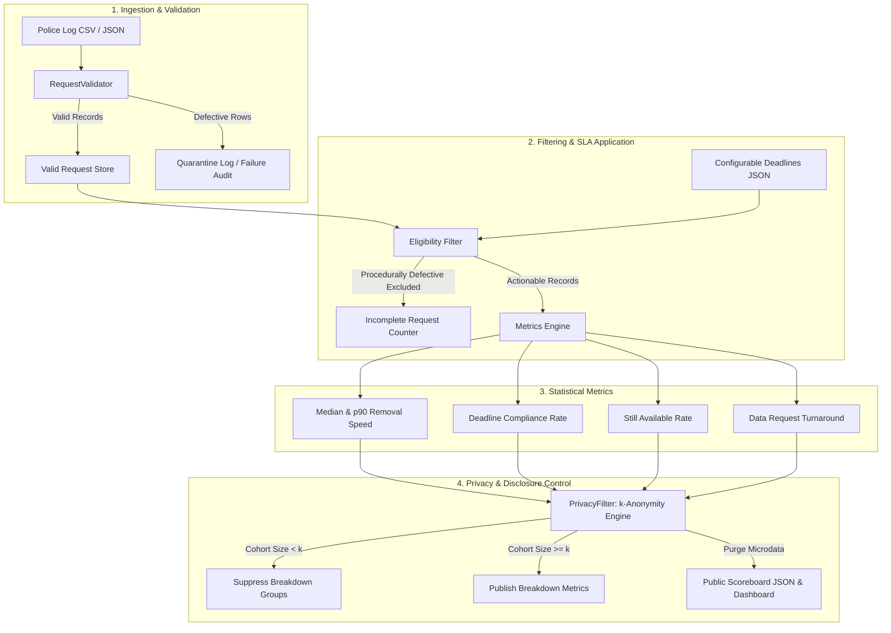

# Methodology & Metric Specifications

This document outlines the scientific definitions, mathematical formulas, data filtering logic, privacy controls, and audit limitations governing **Half 1: Requests and Speed** within the Social Media Takedown Accountability Platform.

> **Demonstration Disclaimer**:
> This platform uses synthetic records and simulated models for public demonstrations, test validation, and reference calibration. Figures generated from synthetic data do not represent genuine intermediary compliance, actual platform responsiveness, or real police investigations.

---

## 1. System Dataflow & Processing Architecture

---

## 2. Metric Specifications

### 2.1. Median Content Removal Time

* **Definition & Purpose**: The 50th percentile duration (in hours) between police dispatch of an actionable takedown request and the intermediary's recorded removal or disablement of the targeted content. Provides the central tendency of removal speed resilient to extreme outliers.
* **Timestamps Used**: `sent_at` (dispatch timestamp) and `claimed_removal_at` (removal confirmation timestamp).
* **Formula**:
  $$\text{Duration}_i = \frac{\text{claimed\_removal\_at}_i - \text{sent\_at}_i}{3600}$$
  $$\text{Median Removal Hours} = \text{Percentile}_{50}(\{\text{Duration}_i \mid i \in \text{CompletedTakedowns}\})$$
* **Eligibility & Exclusions**:
  - Eligible subset: Records where `request_type == 'takedown'` and `is_complete_request == true`.
  - Completed subset: Eligible records where `status == 'claimed_removed'` and `claimed_removal_at` is non-null.
  - Excluded: Procedurally incomplete requests (`is_complete_request == false`), requests pending action, rejected requests, and data requests.
* **Missing & Unresolved Records**: Unresolved requests (content still available) do not have a `claimed_removal_at` timestamp and are excluded from the speed distribution calculation, but are penalised under the **Deadline Compliance Rate** and tracked in the **Still Available Rate**.

---

### 2.2. 90th-Percentile Content Removal Time (p90)

* **Definition & Purpose**: The time threshold within which 90% of completed content removals are executed. Identifies tail latencies, operational bottlenecks, escalation friction, and prolonged content exposure.
* **Calculation Method**: Linear interpolation between closest ranks over sorted completed removal durations:
  $$\text{Rank} = \frac{90}{100} \times (n - 1)$$
  $$\text{p90} = X_{\lfloor \text{Rank} \rfloor} + (\text{Rank} - \lfloor \text{Rank} \rfloor) \times \left(X_{\lceil \text{Rank} \rceil} - X_{\lfloor \text{Rank} \rfloor}\right)$$
* **Eligibility & Exclusions**: Identical to Median Content Removal Time.

---

### 2.3. Deadline Compliance Rate (%)

* **Definition & Purpose**: The percentage of legally complete, actionable police takedown requests that were resolved by the intermediary within the applicable statutory or priority deadline.
* **Numerator**: Count of eligible takedown requests where `status == 'claimed_removed'` and $\text{Duration}_i \le \text{Deadline}_i$.
* **Denominator**: Total count of all eligible takedown requests dispatched within the measurement window:
  $$\text{Denominator} = |\{r \mid r \in \text{Takedowns} \land r.\text{is\_complete\_request} == \text{true}\}|$$
* **Formula**:
  $$\text{Compliance Rate (\%)} = \left(\frac{\text{Numerator}}{\text{Denominator}}\right) \times 100$$
* **Critical Rule on Platform Acknowledgement**:
  A platform's acknowledgement of receipt (`acknowledged_at`) is **never** counted as removal. A request that has been acknowledged but not removed remains in the denominator as non-compliant once the deadline elapses.
* **Configurable Deadlines**:
  - Emergency Life Threat (`priority == 'emergency_life_threat'`): **2.0 hours**
  - Statutory Sexually Explicit / CSAM / NCII: **24.0 hours** (e.g. IT Rules 2021 Rule 3(2)(b))
  - Statutory Court / Government Orders: **36.0 hours** (e.g. Rule 3(1)(d))
  - Routine Default: **36.0 hours**

---

### 2.4. Percentage of Content Still Available (%)

* **Definition & Purpose**: The proportion of actionable takedown requests for which targeted content has not been removed (including pending reviews, expired requests, and platform rejections).
* **Numerator**: Count of eligible takedowns where `status` is not `claimed_removed` (e.g. `pending`, `acknowledged`, `rejected`, `expired`).
* **Denominator**: Total count of eligible takedowns.
* **Formula**:
  $$\text{Still Available Rate (\%)} = \left(\frac{\text{Still Available Count}}{\text{Eligible Takedowns}}\right) \times 100$$

---

### 2.5. Data Request Response Turnaround

* **Definition & Purpose**: Measures intermediary response speed when police seek subscriber metadata, IP logs, or registration details under statutory assistance provisions.
* **Timestamps Used**: `sent_at` and `data_provided_at`.
* **Metrics**: Median response hours, p90 response hours, and 72-hour statutory deadline compliance rate.
* **Denominator**: All complete police data requests dispatched within the measurement period.

---

### 2.6. Incomplete Police Requests Count

* **Definition & Purpose**: Quantifies requests excluded from intermediary penalty due to police-side procedural defects (e.g., missing court orders, invalid URL formatting, unspecified jurisdiction, or missing signature/seal).
* **Purpose**: Prevents intermediary performance from being distorted by legally defective demands, establishing mutual accountability.

---

## 3. Privacy & Disclosure Controls

To guarantee that public scoreboards, APIs, and downloaded reports cannot be used to de-anonymize victims, track specific police operations, or correlate sensitive complaints:

1. **Strict $k$-Anonymity Group Suppression ($k=10$)**:
   - Any disaggregated breakdown group (by intermediary or harm category) containing fewer than 10 cases is suppressed.
   - Suppressed entries report `is_suppressed: true`, nullified statistical values, and an explicit `suppression_reason`.
2. **Permanent Redaction of Identifiers**:
   - Internal request IDs, police station identifiers, victim names, complainant references, and content URLs are permanently excluded from all public scoreboard exports and API payloads.
3. **URL Cryptographic Hashing**:
   - If URL tracking is necessary for re-upload correlation (Half 2 integration), only SHA-256 hashes of normalized synthetic URLs are processed. Raw URLs are never committed or exposed.

---

## 4. Measurement Limitations & Potential Bias

* **Claimed vs Observed Removals**: Half 1 measures intermediary *claimed* removal timestamps (`claimed_removal_at`). Independent observation and detection of false claims is delegated to Half 2 (Verification and Integrity).
* **Working Hours vs 24/7 Clock**: Statutory deadlines (e.g., 24h, 36h) operate on an absolute elapsed clock rather than business hours.
* **Platform Categorization Nuance**: Intermediaries often apply internal Community Standards classifications that differ from statutory police categories.
