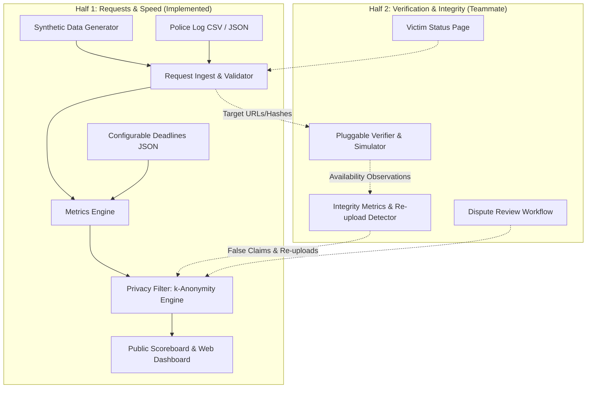

# Social Media Takedown Accountability Platform

[](https://github.com/iamnih4l/takedown-tracking/actions/workflows/ci.yml)
[](https://opensource.org/licenses/Apache-2.0)
[](https://www.python.org/)

An open-source accountability platform designed to audit and publish empirical response speed metrics for social media intermediaries responding to police takedown orders and data assistance requests.

---

## 1. Operating Modes & Deployment Notice

* **Demonstration Mode**: Uses 100% synthetic request records, harmless mock hashes, and simulated platform response profiles. Built for public transparency demonstrations, method calibration, and automated regression testing.
* **Real-World Deployment**: Architected to operate inside an authorized, police-controlled boundary (e.g. prospective Kerala Police cyber infrastructure). All operational data remains strictly segregated within the agency environment.

> **Important Deployment Notice**:
> This open-source repository contains independent accountability tooling. It does not imply existing official integration, direct access to internal law enforcement databases, or formal governmental endorsement.

---

## 2. Architecture & Workstream Division



---

## 3. Shared Data Contracts

Both workstreams interface through shared JSON Schemas located in [`schemas/`](file:///schemas/):

1. **[`request_log.schema.json`](file:///schemas/request_log.schema.json)**:
   Standard contract for individual takedown and data request records. Defines mandatory identifiers, platform enums, harm categories, ISO 8601 UTC timestamps, completeness flags, and synthetic URL hash structures.
2. **[`scoreboard.schema.json`](file:///schemas/scoreboard.schema.json)**:
   Standard contract for public transparency reporting. Embeds metadata, overall aggregate statistics, disaggregated breakdowns by platform and category, configured statutory deadlines, and integration slots for integrity metrics.

---

## 4. Quickstart Guide

### 4.1. Requirements
* Python 3.10, 3.11, or 3.12 (Zero external runtime dependencies; uses Python standard library).
* `pytest` for test execution.

### 4.2. Local Installation
Clone the repository and set your `PYTHONPATH`:

```bash
# On Linux / macOS
export PYTHONPATH=src

# On Windows (PowerShell)
$env:PYTHONPATH="src"
```

### 4.3. Command-Line Interface (CLI)

```bash
# 1. Generate 300 reproducible synthetic records
python -m takedown_tracking.cli generate --count 300 --seed 42 --output data/demo_synthetic_requests.json

# 2. Validate and import request records
python -m takedown_tracking.cli import --input data/demo_synthetic_requests.json --quarantine data/quarantined_errors.json

# 3. Calculate raw performance metrics
python -m takedown_tracking.cli metrics --input data/demo_synthetic_requests.json

# 4. Export privacy-filtered public scoreboard (k=10 suppression)
python -m takedown_tracking.cli export-scoreboard --input data/demo_synthetic_requests.json --output data/demo_public_scoreboard.json --k-threshold 10

# 5. Launch public dashboard and local API server
python -m takedown_tracking.cli serve --host 127.0.0.1 --port 8000 --data data/demo_synthetic_requests.json
```

Navigate to `http://127.0.0.1:8000/` in your browser to view the interactive dashboard.

---

## 5. Teammate Integration Checklist (Half 2)

This implementation provides shared hooks and models ready for **Half 2: Verification and Integrity**:

* [x] **Shared Request Model**: [`RequestRecord`](file:///src/takedown_tracking/models/request.py) includes `content_url_hash` for pluggable verifiers and re-upload hash detectors.
* [x] **Integrity Summary Slot**: [`PublicScoreboard`](file:///src/takedown_tracking/models/scoreboard.py) and [`schemas/scoreboard.schema.json`](file:///schemas/scoreboard.schema.json) provide a designated `integrity_summary` object (`false_removal_claim_rate_pct`, `observed_reupload_rate_pct`, `disputes_active`, `verification_coverage_pct`).
* [x] **Non-Penalizing Observability**: Metrics engine distinguishes claimed removals from observed removals; verifier observations from Half 2 can plug directly into false removal claims calculations.
* [x] **Victim Privacy Guardrails**: Privacy filter ensures internal identifiers (`request_id`, `police_unit_id`) are never exposed in public scoreboard payloads.

### Integration Testing Steps for Half 2
1. Import `RequestRecord` instances into the Verifier Simulator.
2. Run simulated observations and compute false removal rates.
3. Pass `integrity_summary` dictionary into `PublicScoreboard.integrity_summary`.
4. Run `pytest tests` to verify joint schema validity.

---

## 6. Automated Testing

Run the full automated test suite:

```bash
python -m pytest -v tests
```

Tests validate:
* Synthetic data generator determinism and platform distributions.
* Ingestion validation, temporal inversion prevention, and safe error reporting.
* Percentile interpolation (median, p90) and deadline compliance math.
* $k$-anonymity threshold suppression and zero-PII leak guarantees.
* Web server static delivery and API endpoints.

---

## 7. Security & Credential Protection

* **Zero Committed Credentials**: Never hardcode GitHub tokens, API credentials, private keys, or passwords.
* **Authorized Authentication**: Use official credential helpers or environment-injected secrets; never print secrets in terminal sessions or temporary scripts.
* **Immediate Revocation**: Any accidentally exposed token must be revoked immediately via GitHub security settings.
* **Reporting**: Refer to [SECURITY.md](SECURITY.md) for vulnerability disclosure guidelines.

---

## 8. License

Licensed under the [Apache License, Version 2.0](LICENSE).
